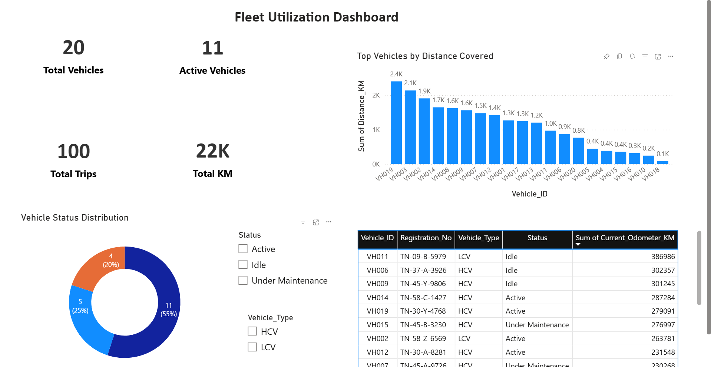
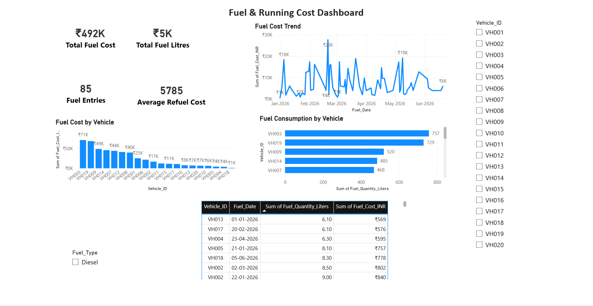
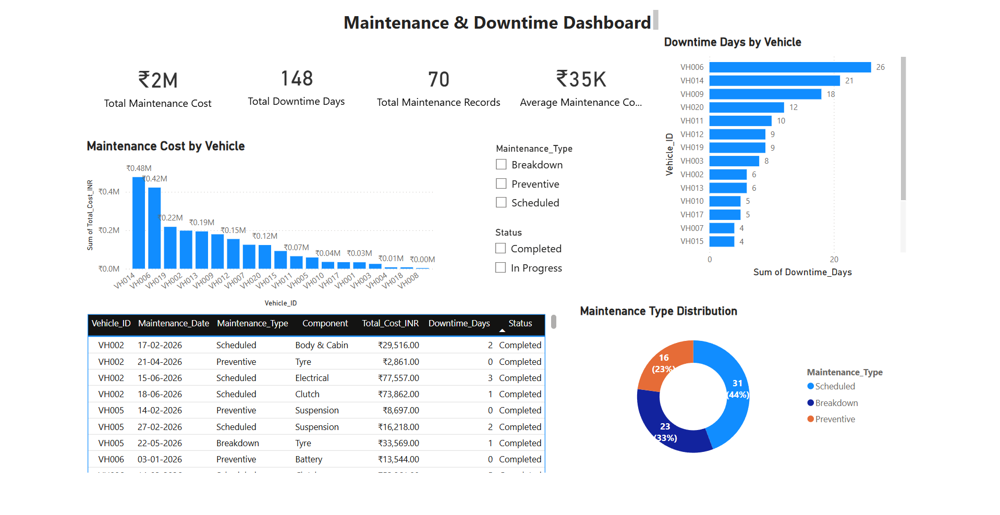
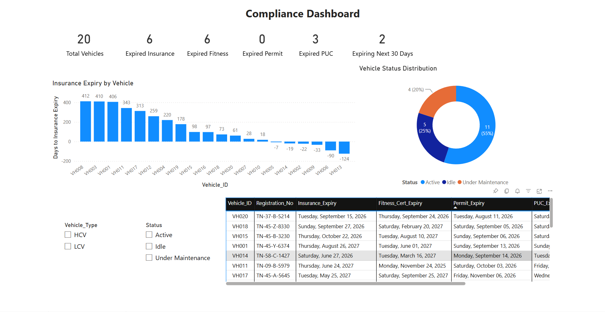
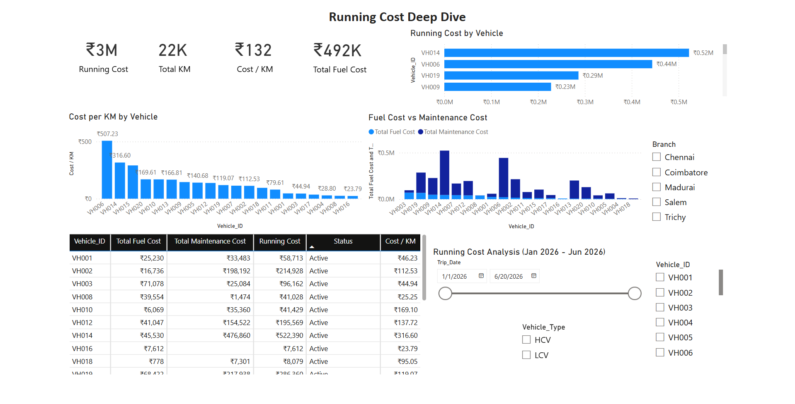
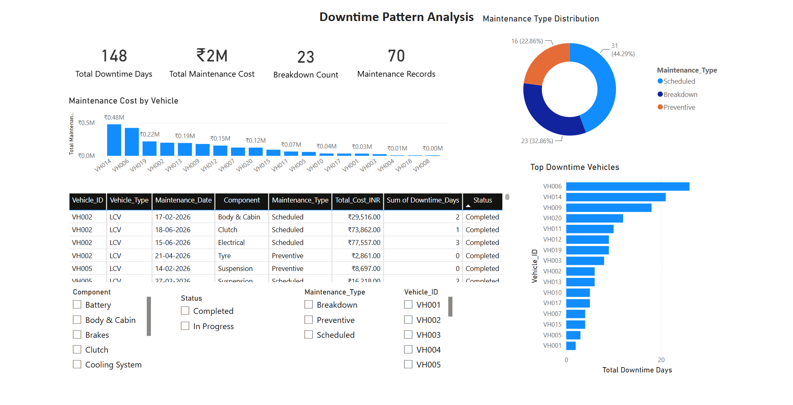
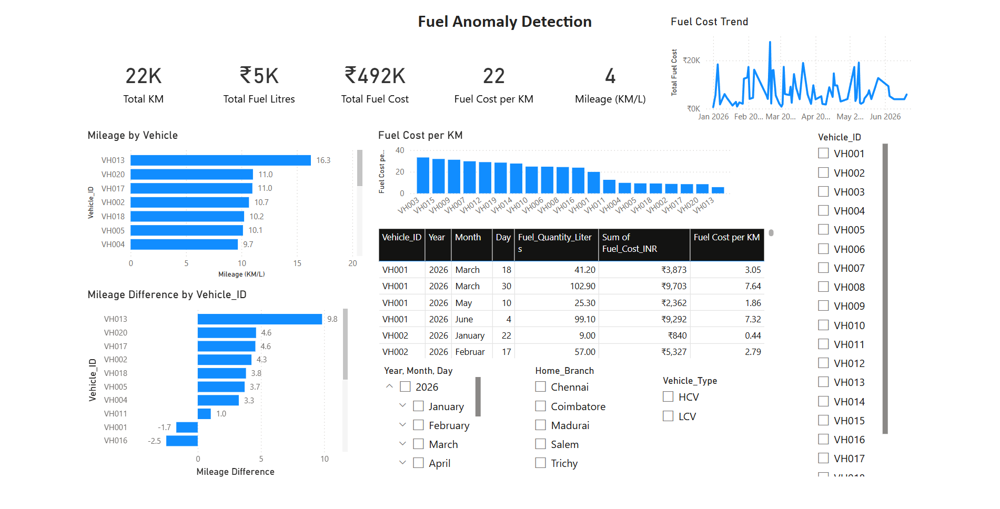
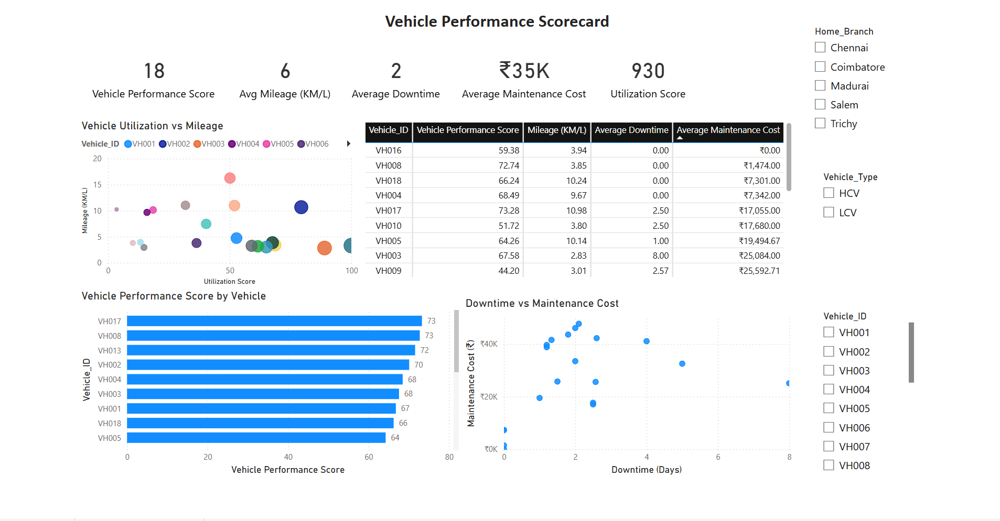
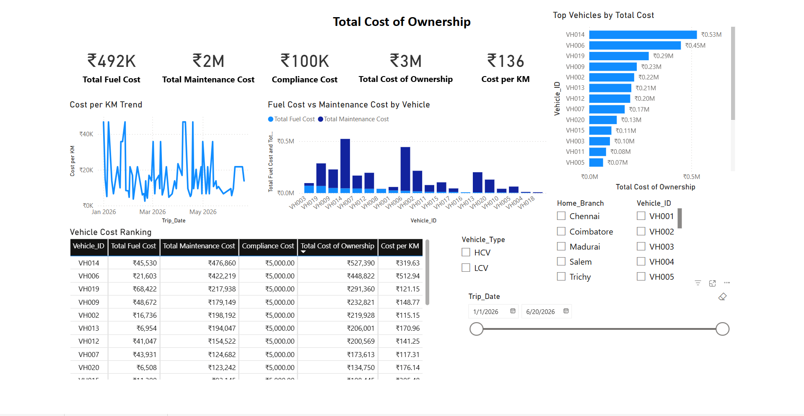

# 🚛 Fleet Management Dashboard

## 📌 Project Overview

This project is an interactive **Fleet Management Dashboard** developed using **Microsoft Power BI** to monitor fleet performance, vehicle utilization, fuel consumption, maintenance costs, compliance status, and business KPIs. The dashboard provides data-driven insights that help organizations optimize fleet operations and improve decision-making.

---

## 🎯 Objective

The primary objective of this dashboard is to help organizations:

- Monitor fleet performance in real time.
- Analyze fuel consumption and operating costs.
- Track maintenance activities and vehicle downtime.
- Improve fleet utilization and efficiency.
- Support business decisions using interactive visualizations.

---

## 🛠️ Tools Used

- Microsoft Power BI
- Power Query
- DAX (Data Analysis Expressions)
- Microsoft Excel

---

## 📊 Dashboard Features

- Executive Dashboard
- Fleet Utilization Analysis
- Fuel Consumption & Running Cost Analysis
- Maintenance & Repair Analysis
- Vehicle Downtime Analysis
- Branch-wise Performance Analysis
- Vehicle Performance Dashboard
- Fuel Anomaly Detection
- KPI Summary Dashboard
- Interactive Filters & Slicers
- KPI Cards
- Charts & Graphs
- Drill-through Reports

---

# 📷 Dashboard Preview

## 📌 Dashboard 1 – Executive Overview

## 🚛 Dashboard 2 – Fleet Utilization Analysis

## ⛽ Dashboard 3 – Fuel Consumption & Running Cost

## 🔧 Dashboard 4 – Maintenance & Repair Analysis

## ⏱️ Dashboard 5 – Vehicle Downtime Analysis

## 📍 Dashboard 6 – Branch-wise Fleet Performance

## 🚚 Dashboard 7 – Vehicle Performance Dashboard

## 🚨 Dashboard 8 – Fuel Anomaly Detection

## 📈 Dashboard 9 – KPI Summary & Business Insights

---

## 📈 Key Insights

- Identified vehicles with the highest running costs.
- Monitored fuel efficiency across the fleet.
- Analyzed maintenance costs and repair trends.
- Tracked vehicle downtime for operational improvements.
- Compared branch-wise fleet performance.
- Detected fuel anomalies using business rules.
- Evaluated overall fleet utilization.
- Monitored key performance indicators (KPIs) for management.

---

## 📂 Dataset

The dashboard uses sample fleet management data containing:

- Vehicle Master
- Driver Master
- Trip Log
- Fuel Log
- Maintenance Log
- Branch Information
- Vehicle Performance Metrics

---

## 👨‍💻 Developed By

**Shiva Dharshan**

Final Year B.Tech Information Technology Student

**Skills:** Power BI • DAX • Power Query • Excel • SQL • Data Analytics
